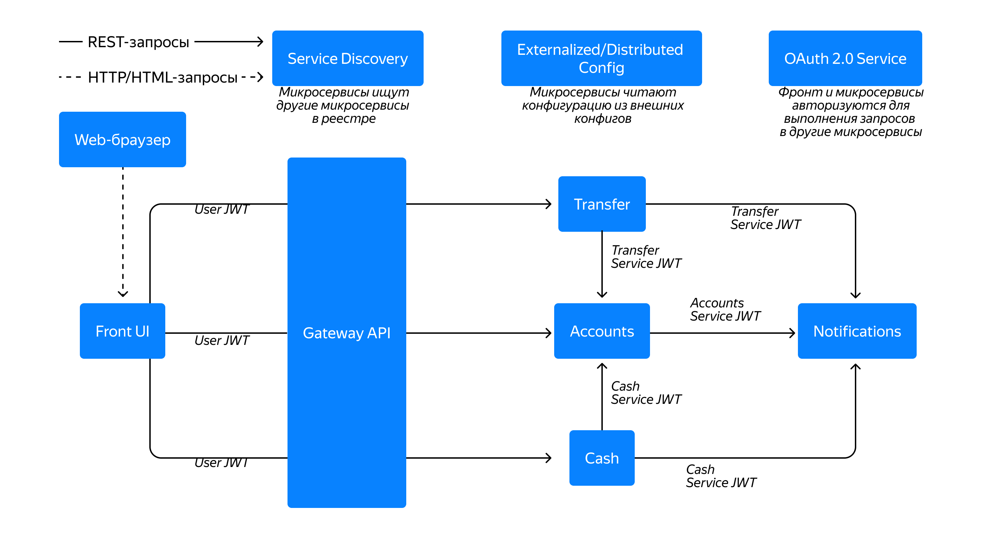

# my-bank-app - микросервисное приложение
Учебный проект: микросервисный «Банк» на Spring Boot/Java 21 со Spring Cloud, OAuth 2.0 (Keycloak), WebFlux и PostgreSQL.

## Порты
| Порт  | Приложение            |
|-------|-----------------------|
| 8760  | Config Server         |
| 8761  | Directory Server      |
| 8080  | front-app             |
| 8081  | gateway-api           |
| 8082  | accounts-service      |
| 8083  | cash-service          |
| 8084  | transfer-service      |
| 8089  | notifications-service |
| 8090  | keycloak              |
| 8091  | PostgreSQL            |

---

## Архитектура

## Роли и права

Авторизация построена по двум потокам OAuth 2.0:

| Поток | Кто использует | Что получает |
|-------|----------------|--------------|
| **Authorization Code Flow** | `front-app` (пользователь банка) | User JWT с ролями пользователя |
| **Client Credentials Flow** | микросервисы между собой | Service JWT с ролями сервисного аккаунта |

### Realm-роли (глобальные)

| Роль | Назначение |
|------|-----------|
| `USER`    | Обычный пользователь банка (клиент) |
| `SERVICE` | Признак сервисного аккаунта |

### Client-роли (по сервисам)

Client-роли привязаны к конкретному клиенту Keycloak и попадают в JWT в claim `resource_access.<client_id>.roles`. Это даёт естественную изоляцию прав между сервисами.

| Client (сервис)         | Client role            | Кто получает | Что разрешает |
|-------------------------|------------------------|--------------|---------------|
| `accounts-service`      | `ACCOUNTS_WRITE`       | user, service | Изменение данных аккаунта и баланса |
| `cash-service`          | `CASH_WRITE`           | user         | Пополнение / снятие денег через фронт |
| `transfer-service`      | `TRANSFER_WRITE`       | user         | Переводы между счетами через фронт |
| `notifications-service` | `NOTIFICATIONS_WRITE`  | service      | Отправка уведомлений из других сервисов |

### Как назначаются роли

**Пользователь банка.** Роль `USER` назначается на вкладке **Users → <user> → Role mapping**, client-роли `ACCOUNTS_WRITE`, `CASH_WRITE`, `TRANSFER_WRITE` — там же, через фильтр **Filter by clients**.

**Сервисный аккаунт.** Каждый сервис-клиент имеет автоматически созданный service account. Роли назначаются на вкладке **Clients → <client> → Service accounts roles**. Например, у `cash-service` там стоят `accounts-service → ACCOUNTS_WRITE` и `notifications-service → NOTIFICATIONS_WRITE`.

## Тестовые пользователи

Все пользователи realm `bank` создаются из `bank-realm.json` при импорте realm. Пароль у всех — `password`.

| Логин    | ФИО               | Дата рождения | Баланс (стартовый) | Realm role | Client roles |
|----------|-------------------|---------------|--------------------|-----------|--------------|
| `login1` | Федя Сумкин       | 1990-01-01    | 1000.00            | `USER` | `ACCOUNTS_WRITE`, `CASH_WRITE`, `TRANSFER_WRITE` |
| `login2` | Пётр Петров       | 1985-05-05    | 500.00             | `USER` | `ACCOUNTS_WRITE`, `CASH_WRITE`, `TRANSFER_WRITE` |
| `login3` | Дмитрий Петров    | 1985-05-05    | 0.00               | `USER` | `ACCOUNTS_WRITE`, `CASH_WRITE`, `TRANSFER_WRITE` |

> ⚠️ **Важно.** `accounts.login` в таблице `accounts.accounts` **должен совпадать** с `username` в Keycloak. Контроллер берёт логин из claim `preferred_username` и делает `findByLogin(...)` — при расхождении вернётся 404 «Аккаунт не найден».

### Быстрый вход

| Пользователь | Пароль    |
|--------------|-----------|
| `login1`     | `password` |
| `login2`     | `password` |
| `login3`     | `password` |

### Администратор Keycloak

| Логин | Пароль | Роль |
|-------|--------|------|
| `admin` | `admin` | Администратор Keycloak |

Открыть: `http://localhost:8090` → Administration Console.

---

## Сервисные аккаунты

Создаются автоматически при `serviceAccountsEnabled: true`.

| Service account | Исходящие роли |
|-----------------|----------------|
| `service-account-accounts-service` | `notifications-service → NOTIFICATIONS_WRITE` |
| `service-account-cash-service`     | `accounts-service → ACCOUNTS_WRITE`, `notifications-service → NOTIFICATIONS_WRITE` |
| `service-account-transfer-service` | `accounts-service → ACCOUNTS_WRITE`, `notifications-service → NOTIFICATIONS_WRITE` |

Секреты клиентов (из `bank-realm.json`, только для dev):

| Client | Secret |
|--------|--------|
| `accounts-service`      | `accounts-secret` |
| `cash-service`          | `cash-secret` |
| `transfer-service`      | `transfer-secret` |
| `notifications-service` | `notifications-secret` |
| `gateway`               | `gateway-secret` |
| `front-ui`              | public (PKCE) |

---